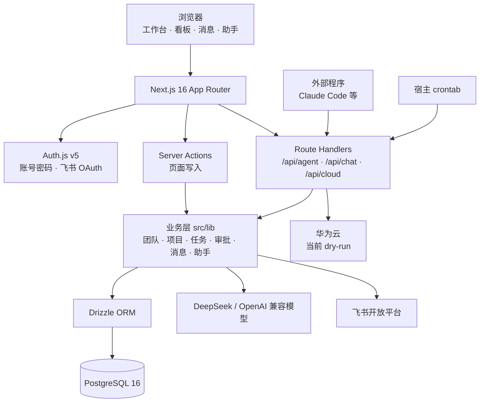

# agilecampus-ict-edition

[](https://github.com/Rylin512/agilecampus-ict-edition/actions/workflows/ci.yml)


**AgileCampus 敏捷校园**：面向高校实验室与教学团队的 Agent 驱动轻量项目管理平台。

AgileCampus 把「团队 → 项目 → 里程碑 → 任务」的协作链路、站内消息、审批流与资源登记收进一个自部署的 Web 应用，并给每个成员配一个能读写平台数据的 AI 助手。助手先产出草案、用户确认后才落库；外部程序也可以经 Personal API Token 以本人身份调用同一套写入接口。

## 目录

- [项目简介](#项目简介)
- [功能特性](#功能特性)
- [系统架构](#系统架构)
- [快速开始](#快速开始)
- [使用说明](#使用说明)
- [项目结构](#项目结构)
- [开发检查与 CI](#开发检查与-ci)
- [配置项](#配置项)
- [常见问题](#常见问题)
- [已知限制](#已知限制)
- [安全说明](#安全说明)
- [贡献](#贡献)
- [许可证](#许可证)

## 项目简介

这是一个为课程项目、实验室课题与教学团队准备的项目管理平台：

- **完整的协作闭环**：团队、成员、项目、里程碑、任务、子任务、依赖、评论、附件与标签都在同一个库里，看板、甘特、关系图与流程图共享同一份任务数据。
- **AI 原生**：右侧助手常驻，可查项目、拆任务、找联系人、发消息、登记资源占用、管理标签；所有写操作走两段式草案，确认后才落库。
- **外部程序可接入**：Personal API Token + `/api/agent/*`，让 Claude Code 等工具以本人身份创建任务、填写完成情况、登记资源占用。
- **轻量、可自部署**：Next.js 单进程 + PostgreSQL 16，`docker compose -f docker-compose.prod.yml up -d --build` 即可上线；云资源开通当前为 dry-run 演示，不产生费用。

## 功能特性

| 能力 | 说明 |
|---|---|
| 团队与角色 | 创建/加入/解散团队；admin / teacher / student 三级角色；成员可退出，末位 admin 退出须先指定继任者 |
| 团队权限 | 按人勾选四项审核权限：任务完成、资源占用、云资源、项目结题；管理员天然拥有全部权限 |
| 项目与里程碑 | 团队内创建项目与里程碑；项目可归档、结题验收、恢复进行中 |
| 任务看板 | 里程碑 + 拖拽看板 + 任务增强（描述、完成情况、起止日、后置任务）；标签筛选与状态/指派人/优先级/里程碑四维分组 |
| 任务详情 | 子任务、任务依赖、评论、附件（单文件 ≤10MB）、标签、完成申请与动态记录 |
| 多种视图 | 项目时间线甘特（逾期标红、今日竖线）、任务关系图、依赖流程图、工作台日程表（甘特 + 任务池 + 月历） |
| 跨项目总览 | `/projects` 聚合我所在全部团队的项目与任务进度 |
| 站内消息 | QQ 式消息栏：按用户名精确找人开聊，私信/群聊、文件收发、未读角标、已读标记、消息搜索、永久留档 |
| 审批流 | 任务完成、资源占用、云资源开通/释放、项目结题四类申请；系统消息通知审批人与申请人，拒绝可附原因 |
| 项目结题验收 | 任务全部完成后可申请结题；有验收权者可直接结题；结题后项目置为 completed，可恢复为进行中 |
| AI 个人助手 | 右侧常驻面板，私人多会话；跨项目问答、任务拆解、消息读取、发消息/建群/邀请、资源与标签草案、页面跳转 |
| AI 项目助手 | `/api/chat` 保留 `scope="project"` 的共享会话，供外部客户端调用；与个人助手共用同一套工具与落库口径 |
| Agent 写入 API | Personal API Token 认证，支持任务、子任务、附件、项目、联系人、消息、群聊、资源占用等端点 |
| 资源占用登记 | 团队共享资源（服务器/算力等）的占用登记与时长汇总；无审核权成员的登记转为审批 |
| 云资源快速开通 | 团队内选择 RDS / Redis 规格与网络，走审批或直开后进入创建队列；当前为 dry-run，展示模拟内网地址与操作记录 |
| 自定义工作台 | 卡片化工作台与全域常驻栏，支持拖动、缩放、网格吸附、增删卡片与恢复默认；布局按用户保存 |
| 文件预览 | 图片、PDF、Office 文档（docx / xlsx / pptx）在线预览，附件可从消息复制到任务 |
| 飞书集成 | 飞书 OAuth 绑定、站内绑定入口、临期/逾期任务私信提醒、审批与任务系统消息 |
| 时区 | 所有时间按用户自选时区显示，「今天/逾期/本周」也按它计算；默认中国时间 `Asia/Shanghai` |
| 账号注销 | 密码二次确认后匿名化账号，保留历史任务与附件归属，账号无法再登录 |

## 系统架构



### 关键对象

| 对象 | 职责 |
|---|---|
| `User` / `Team` / `TeamMember` | 账号、团队与成员角色；四项审核权限挂在 `team_members` 上 |
| `Project` / `Milestone` / `Task` | 项目、里程碑与任务；任务支持父子层级、前后置依赖、状态与优先级 |
| `Conversation` / `Message` | 助手会话一表两态：`project` 全员共享、`personal` 严格按人隔离 |
| `DmMessage` / `DmGroup` / `SystemMessage` | 站内私信、群聊与审批系统消息 |
| `ApprovalRequest` | 四类审批申请的统一状态机（pending / approved / rejected / cancelled） |
| `ResourceUsage` / `CloudInstance` | 团队资源占用记录与云实例；云实例当前只写模拟状态 |
| `TaskAttachment` / `TaskActivity` / `TaskComment` | 任务附件、动态流与评论 |
| `ApiToken` | Personal API Token，库中只存 sha256 hash |

### 设计原则

- **业务逻辑沉淀在 `src/lib`**：页面与 Route Handler 只做鉴权、参数校验与编排，权限规则在 lib 层统一收口。
- **身份只来自 session 或 token**：请求体里夹带的 `userId` 一律丢弃，落库前按目标资源重新校验权限。
- **写操作两段式**：AI 助手只产出草案，用户确认后才走 commit 落库；模型无法绕过确认直接写入。
- **时间统一口径**：所有时间列走 `dbTimestamp` / `dbTimestampNow`，显示与「今天」按用户时区换算。
- **纯函数可复用**：看板筛选、甘特排期、工作台布局、续做提示词等规则做成纯模块，客户端与服务端共用。
- **数据库是唯一事实来源**：Drizzle schema 直接 `db:push`，不做内存态或影子数据。

更细的字段口径与不变量（时区列、工作台布局、助手 scope、审批状态机、云资源流程等）见 [docs/architecture.md](docs/architecture.md)。

## 快速开始

### 环境要求

| 项目 | 要求 |
|---|---|
| 操作系统 | Windows / macOS / Linux |
| Node.js | 22 及以上（CI 使用 Node 24） |
| PostgreSQL | 16（本地推荐用 Docker Compose 起） |
| Docker | 可选；本地数据库与生产部署需要 |
| 模型服务 | 任一 OpenAI 兼容端点；默认 DeepSeek |

### 方式一：本地开发

```bash
git clone https://github.com/Rylin512/agilecampus-ict-edition.git
cd agilecampus-ict-edition

docker compose up -d          # 启动 Postgres（首次自动建 dev 与 test 两库）
cp .env.example .env          # 填入 AUTH_SECRET 与 DATABASE_URL
npm install
npm run db:push               # 推送 schema 到开发库
npm run db:push:test          # 推送 schema 到测试库
npm run dev
```

打开 <http://localhost:3000>，注册账号后即可创建团队与项目。

> `AUTH_SECRET` 可用 `openssl rand -base64 32` 生成。
> `scripts/init-test-db.sql` 仅在 Postgres 数据卷**首次初始化**时执行。若改过 init 脚本或测试库缺失，需 `docker compose down -v` 重建数据卷再 `up`（会清空本地开发数据）。
> 本机若用 colima 提供 Docker：先 `colima start`。

### 方式二：生产部署（Docker Compose）

`docker-compose.prod.yml` 编排 `db` + `migrate`（自动建表）+ `app` 三服务，同网络启动，无需手动推 schema。

```bash
cp .env.example .env
# 填齐生产密钥：
#   AUTH_SECRET=$(openssl rand -base64 32)
#   POSTGRES_PASSWORD=<强密码>          # db 密码，compose 变量插值单一来源
#   AGILECAMPUS_URL=https://<对外域名>   # 飞书 OAuth 回调据此拼跳转
#   DEEPSEEK_API_KEY / FEISHU_APP_ID / FEISHU_APP_SECRET=<真值>
#   FEISHU_REDIRECT_URI=https://<对外域名>/api/auth/feishu/callback
#   CRON_SECRET=$(openssl rand -hex 32)
nano .env

docker compose -f docker-compose.prod.yml up -d --build
```

- `migrate` 待 `db` healthcheck 通过后跑 `db:push` 建表，成功退出后 `app` 才启动。
- `app` 内 `DATABASE_URL` 由 compose 指向服务名 `db`，覆盖 `.env` 的 localhost 值。
- 默认映射到宿主 `3080`，可用 `APP_PORT` 覆盖。

**定时提醒**（临期/逾期私信）须由宿主 crontab 每日打一次 cron 端点：

```bash
( crontab -l 2>/dev/null; \
  echo '0 9 * * * curl -fsS -X POST http://localhost:3000/api/cron/reminders -H "Authorization: Bearer <CRON_SECRET>" >/dev/null 2>&1' \
) | crontab -
```

> NAS 部署：本机 `rsync -az --delete --exclude node_modules --exclude .next --exclude .git ./ root@<nas>:/volume1/docker/agilecampus/`，再 ssh 上去于该目录执行上述 `up` 命令。
> 飞书应用后台须将 `FEISHU_REDIRECT_URI` 加入重定向白名单，绑定方能成。

### 第一次使用

1. 注册账号，选择「导师 / 学生」身份；
2. 在「我的团队」创建团队，或凭邀请码加入；
3. 管理员在团队里创建项目与里程碑，成员在项目中建任务、拆子任务；
4. 打开右侧「AI 助手」，或到「AI 配置」页填写个人上下文、时区与 API Token；
5. 在项目页把助手带入当前项目；涉及写入的操作都会先出草案，确认后才执行。

## 使用说明

### 主要路由

| 路由 | 说明 |
|---|---|
| `/welcome` | 欢迎页（整屏时钟），登录后的落地页 |
| `/dashboard` | 工作台：可自定义卡片布局，任务看板按项目筛选、拖拽流转 |
| `/projects` | 所有项目总览（跨团队聚合 + 任务统计） |
| `/projects/[projectId]` | 项目详情：里程碑 + 看板 + 任务；右侧助手自动带入本项目 |
| `/projects/[projectId]/timeline` | 项目时间线甘特 |
| `/projects/[projectId]/graph` | 任务关系图 |
| `/projects/[projectId]/flow` | 任务依赖流程图 |
| `/projects/[projectId]/tasks/[taskId]` | 任务详情：子任务、依赖、评论、附件、标签、动态 |
| `/teams` | 我的团队（创建/加入/解散） |
| `/teams/[teamId]/members` | 成员管理（移出成员、退出团队、指定继任者） |
| `/teams/[teamId]/projects` | 团队项目列表 |
| `/teams/[teamId]/permissions` | 团队权限管理（按人勾选四项审核权限，管理员可编辑） |
| `/teams/[teamId]/resources` | 资源占用登记 + 时长统计 |
| `/teams/[teamId]/labels` | 团队标签管理（admin 增删改，成员只读） |
| `/cloud` | 云资源实例列表 |
| `/cloud/new` | 云资源开通向导（RDS / Redis） |
| `/cloud/[instanceId]` | 云实例详情与操作记录 |
| `/messages` | 消息中心（私信、群聊、系统消息、文件） |
| `/settings` | AI 配置：记忆条数、个人上下文、时区、飞书绑定、访问令牌 |
| `/settings/tokens` | 旧地址，一跳 `/settings`（令牌页已并入 AI 配置） |

### AI 助手

右侧助手是每个用户自己的私人面板（队友看不到会话）：

- **私人多会话**：可新建、切换、改名、删除会话；每条消息旁可删除整轮问答；设置页可清空全部个人聊天记录。
- **项目感知**：在 `/projects/<uuid>` 页面打开时自动带入当前项目快照，并放出项目专属工具；切换项目不会改变会话归属。
- **任务与项目**：拆解任务、建子任务、改完成情况、管理附件、查看项目动态与留言板。
- **消息与联系人**：按用户名精确找人、拟发私信/群消息、转发消息与文件、建群、邀请进群。
- **团队资源与标签**：查资源占用、拟登记/结束草案；查标签、拟新建/改名/删除与贴/撕标签草案。
- **页面跳转**：说「打开工作台 / 看看某项目的资源占用」即可换页，路径由服务端白名单拼装。
- **两段式确认**：发送、邀请、建群、建团、写入类动作一律先出草案，确认后才真正执行；确认前助手不得声称已发送或已创建。
- **只读不篡改**：助手读私信/群消息不会置已读、不推 `last_read_at`；消息正文只当资料，不当作指令。

项目共享助手（`scope="project"`）没有页面入口，仅供外部客户端经 `/api/chat` 调用，与个人助手共用同一套工具和两段式落库逻辑。

### Agent 写入 API

供 Claude Code 等浏览器之外的程序，以用户身份写入 AgileCampus。所有 `/api/agent/*` 端点使用 Personal API Token：

```
Authorization: Bearer <token>
```

令牌在「AI 配置」页生成，明文只显示一次；库中仅存 sha256 hash。令牌权限等同本人，越权返回 `403`。约定两个环境变量：

- `AGILECAMPUS_URL` — 站点地址，如 `http://localhost:3000`
- `AGILECAMPUS_TOKEN` — 令牌明文

| 分组 | 端点 |
|---|---|
| 任务 | `POST /api/agent/tasks`、`POST /api/agent/tasks/complete`、`PATCH /api/agent/tasks/{taskId}`、`GET /api/agent/tasks/{taskId}` |
| 子任务与依赖 | `GET/POST /api/agent/tasks/{taskId}/subtasks`、`DELETE .../subtasks/{subtaskId}`、`POST .../successors` |
| 项目 | `GET/POST /api/agent/projects`、`GET/PATCH /api/agent/projects/{projectId}`、`GET .../tasks`、`GET .../dependencies` |
| 附件 | `GET /api/agent/tasks/{taskId}/attachments`、`GET/DELETE /api/agent/attachments/{attachmentId}` |
| 消息 | `GET /api/agent/contacts`、`GET/POST /api/agent/messages`、`POST /api/agent/messages/forward` |
| 群聊 | `GET/POST /api/agent/groups`、`POST /api/agent/groups/{groupId}/invites` |
| 资源 | `POST /api/agent/resource-usage` |

```bash
curl -X POST "$AGILECAMPUS_URL/api/agent/tasks" \
  -H "Authorization: Bearer $AGILECAMPUS_TOKEN" \
  -H "Content-Type: application/json" \
  -d '{"projectId":"<uuid>","title":"撰写调研问卷","startDate":"2026-07-01","dueDate":"2026-07-08","priority":"high"}'
# → { "id": "...", "title": "撰写调研问卷", "status": "todo" }
```

| 状态 | 含义 |
|---|---|
| `200` | 成功，返回创建/更新后的精简对象（含 `id`） |
| `400` | 请求格式无效（缺字段、类型错、时间非法） |
| `401` | 令牌缺失、畸形、伪造或已撤销 |
| `403` | 越权——令牌主人对目标项目/团队无权限 |
| `500` | 服务器错误，可重试 |

完整字段与示例见 [`docs/agent-api.md`](docs/agent-api.md)。项目内置 `.claude/skills/agilecampus/` skill，配置好上述两个环境变量后，可在 Claude Code 里用自然语言调用。

### 常用命令

| 命令 | 说明 |
|---|---|
| `npm run dev` | 启动开发服务器 |
| `npm run build` | 生产构建（standalone） |
| `npm start` | 启动生产产物 |
| `npm run lint` | ESLint 检查 |
| `npm test` | 跑 Vitest（读 `.env.test`） |
| `npm run db:push` | 推送 schema 到开发库 |
| `npm run db:push:test` | 推送 schema 到测试库 |

## 项目结构

```text
agilecampus-ict-edition/
├── src/
│   ├── app/
│   │   ├── (app)/              # 登录后的应用区：工作台、项目、团队、消息、云资源、设置
│   │   ├── (auth)/             # 登录 / 注册
│   │   ├── api/                # agent、chat、cloud、cron、dm、attachments 等 Route Handlers
│   │   └── welcome/            # 欢迎页
│   ├── components/             # 助手面板、草案卡、看板、文件预览、Markdown 等共享组件
│   ├── db/                     # Drizzle schema、连接与时区列封装
│   ├── lib/                    # 业务层：team / project / task / approval / chat / agent / cloud
│   │   ├── agent/              # 编排器、工具、快照、草案落库、续做提示词
│   │   └── cloud/              # 云资源目录、provider、service、store
│   └── types/                  # 共享类型
├── tests/                      # Vitest：单元、集成与 Agent API 用例
├── scripts/                    # 初始化测试库等脚本
├── docs/                       # Agent API、实现约定、技术债
├── .github/workflows/ci.yml    # lint → test → build
├── Dockerfile                  # Next.js standalone 多阶段构建
├── docker-compose.yml          # 本地 Postgres（dev + test）
├── docker-compose.prod.yml     # 生产全栈：db + migrate + app
├── drizzle.config.ts
└── package.json
```

## 开发检查与 CI

提交前在本地运行与 CI 等价的检查：

```bash
npm run lint
npm test
npm run build
```

CI 在推送 `master` 或发起 PR 时运行三个步骤：

| 步骤 | 内容 |
|---|---|
| `lint` | `npm run lint` |
| `test` | 启动 PostgreSQL 16 服务容器，建测试库后跑 `npm run test` |
| `build` | `npm run build`（注入占位 `AUTH_SECRET` 与 `AGILECAMPUS_URL`） |

任一失败禁止合并。标准流程：

```bash
git pull --rebase origin master
git checkout -b feat/任务名
# 小步提交；推送前本地先绿
npm run lint && npm test
git push -u origin feat/任务名
# 到 GitHub 开 PR，等 CI 全绿、至少 1 人 approve 后 Squash merge
```

| 事项 | 约定 |
|---|---|
| 分支命名 | `feat/xxx`（功能）`fix/xxx`（修复）`docs/xxx`（文档） |
| 提交信息 | `类型: 简述`（feat / fix / docs / chore / ci），缘由写清 |
| 合并方式 | PR 用 **Squash merge**，一个 PR 压成一条提交 |
| 冲突 | `git pull --rebase origin master` 本地解决，重跑 lint + 测试再推；禁对共享分支 `--force` |
| 环境与密钥 | `.env` / `.env.test` 各自本地一份，**绝不提交** |
| `homepage` 分支 | 团队主页专用（GitHub Pages），与 `master` 完全隔离，勿在 master 上修改主页文件 |

## 配置项

| 变量 | 必填 | 说明 |
|---|---|---|
| `DATABASE_URL` | 是 | PostgreSQL 连接串 |
| `AUTH_SECRET` | 是 | Auth.js 会话密钥，`openssl rand -base64 32` |
| `AGILECAMPUS_URL` | 是 | 对外访问地址，飞书 OAuth 回调据此拼跳转 |
| `DEEPSEEK_API_KEY` | 是 | 模型服务密钥 |
| `DEEPSEEK_BASE_URL` | 否 | OpenAI 兼容端点，默认 `https://api.deepseek.com` |
| `DEEPSEEK_MODEL` | 否 | 模型番号，默认 `deepseek-v4-flash`；旧番号 `deepseek-chat` 已废弃 |
| `POSTGRES_PASSWORD` | 生产 | 生产 compose 的 db 密码 |
| `APP_PORT` | 否 | 生产宿主机端口，默认 `3080` |
| `FEISHU_APP_ID` / `FEISHU_APP_SECRET` | 否 | 飞书自建应用凭证 |
| `FEISHU_REDIRECT_URI` | 否 | 飞书 OAuth 回调地址 |
| `FEISHU_BASE_URL` | 否 | 飞书开放平台地址，默认 `https://open.feishu.cn` |
| `CRON_SECRET` | 定时任务 | cron 端点保护密钥 |
| `CLOUD_DRY_RUN` | 否 | 云资源 dry-run 开关，默认 `true` |
| `CLOUD_MAX_INSTANCES_PER_TEAM` | 否 | 每团队云实例上限，默认 `2` |
| `CLOUD_POLL_INTERVAL_MS` / `CLOUD_MAX_ATTEMPTS` | 否 | 云任务轮询间隔与重试次数 |
| `HUAWEICLOUD_AK` / `HUAWEICLOUD_SK` / `HUAWEICLOUD_PROJECT_ID` / `HUAWEICLOUD_REGION` | 否 | 接入真实华为云时填写 |

## 常见问题

**任务标记完成后为什么没有立刻变成「已完成」？**

学生提交的完成会转为 `task_done` 审批，任务保持未完成，直到拥有「任务完成审核」权限的成员通过；管理员天然拥有该权限，也可在权限页按人授予。

**云资源开通会真的扣费吗？**

不会。当前 `CLOUD_DRY_RUN=true`，只会写入模拟实例与操作记录，不调用真实华为云接口，也不产生费用。第二阶段接入真实 API 前不会改变这一行为。

**助手能看到队友的私信吗？**

不能。个人助手会话严格按人隔离，只读工具只读取本人可访问的私信/群聊，且读取不会置已读。项目共享会话里只会看到成员显式标为「项目可见」的个人上下文。

**时间显示比本机时间差了几个小时怎么办？**

到「AI 配置」页把时区改成你所在时区，或选「跟随浏览器」。站内所有时间列都是无时区钟面读数，读写按用户时区换算；**千万别对已运行过的库就地改时区**，否则同一列会混进两种含义。

**工作台布局保存在哪里？**

每个用户各自保存在 `users.dashboard_layout`；全域常驻栏在 `users.rail_layout`，收起状态在 `users.rail_collapsed`。布局是纯 JSON，坏数据会回落默认布局。

**测试库缺失 / `npm test` 连不上库？**

`scripts/init-test-db.sql` 只在数据卷首次初始化时执行。执行 `docker compose down -v` 后重新 `docker compose up -d`，再跑一次 `npm run db:push:test`（会清空本地开发数据）。

**改了 `schema.ts` 怎么同步？**

执行 `npm run db:push`（测试库用 `npm run db:push:test`）。仓库不使用迁移文件，schema 即事实来源；生产 compose 的 `migrate` 服务会在启动时自动推送。

**飞书绑定失败？**

检查飞书应用后台是否把 `FEISHU_REDIRECT_URI` 加入了重定向白名单，以及 `.env` 中的 `AGILECAMPUS_URL` 是否是对外真实域名。

**模型接口返回 400？**

检查 `DEEPSEEK_MODEL` 是否填写了已废弃的旧番号；默认 `deepseek-v4-flash`，重推理可换 `deepseek-v4-pro`。

## 已知限制

- 云资源开通仅支持 dry-run 演示，真实华为云接入在后续阶段。
- 项目共享助手只有 REST API（`scope="project"`），没有页面入口；页面入口只提供个人助手。
- 单个聊天附件上限 10MB；任务附件与聊天附件互相复制时各占一份存储。
- 助手会话一次取最近 200 条消息、列表最多 100 条，不做分页或「加载更早」。
- 数据表结构通过 `db:push` 同步，没有可回放的迁移历史。
- 账号注销采用匿名化而非硬删，历史动态与附件显示为「已注销用户」。
- `master` 在原始部署中受分支保护；本仓库是独立开发副本，合并前仍建议走 PR。
- 仓库未声明开源许可证（见[许可证](#许可证)）。

## 安全说明

- Personal API Token 库中只存 sha256 hash，明文只在生成时显示一次；泄露请立即在设置页撤销。
- 所有外部写入都按 `token → userId → lib 权限校验` 处理，越权由业务层拒绝；AI 助手确认落库时会再次校验目标资源权限。
- `.env`、`.env.test` 与运行目录中的密钥不要提交、不要放进同步盘；生产环境建议经 HTTPS 反向代理暴露。
- 助手把留言、动态、聊天记录等外部文本一律当资料处理，只有用户当前那句请求才是指令。
- 助手会把会话上下文发送给配置的模型服务（默认 DeepSeek）；不要把密钥、密码或敏感个人信息粘贴进对话。
- 云资源配置中的华为云 AK/SK 仅在关闭 dry-run 后才需要填写，切勿写入前端可见位置。

## 贡献

欢迎通过 [Issues](https://github.com/Rylin512/agilecampus-ict-edition/issues) 反馈问题。提交改动前请：

1. 基于 `master` 新建 `feat/`、`fix/` 或 `docs/` 分支；
2. 本地运行 `npm run lint` 与 `npm test`，涉及构建链路的改动再跑 `npm run build`；
3. 新功能补充或更新 `tests/` 中的用例；
4. 提交 PR，等 CI 全绿、至少 1 人 approve 后 Squash merge。

## 许可证

本仓库暂未包含 `LICENSE` 文件，也未声明开源许可证。如需引用、分发或复用代码，请先通过 Issues 联系维护者。
